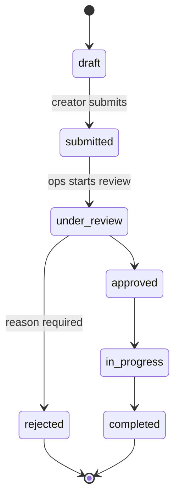
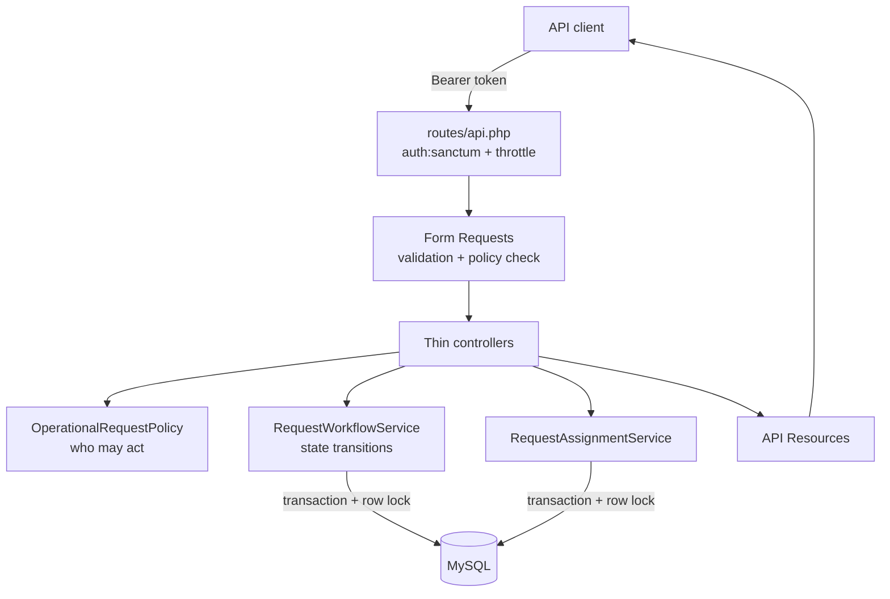

# OpsFlow AI

An internal operations platform built with Laravel 13 and MySQL. Employees raise operational requests (access, infrastructure, incidents, compliance reviews, billing issues and more), and operations staff move them through a controlled, auditable lifecycle.

## Features (implemented)

- **Token authentication** with Laravel Sanctum. Login is rate-limited and returns the same error whether the email is unknown or the password is wrong.
- **Three roles**: `employee`, `manager` and `admin`, enforced server-side by a Laravel Policy.
- **Workflow engine** with an explicit state graph. Requests cannot skip or reverse states, and an invalid move returns a structured `409`.
- **Status history**: every transition records who made it, the from/to states and an optional reason.
- **Assignment** of requests to operations staff, with a full reassignment log.
- **Filtering and pagination** on the request list (`status`, `priority`, `category`, `assigned_to`, `created_by`, `per_page`).
- **Form Request validation** on every write endpoint and on list filters.
- **API Resources**, so responses never expose raw models.
- **Factories and a seeder** that walks requests through the real workflow, so seeded history is consistent.

## Request lifecycle



The graph is defined once, in `App\Enums\RequestStatus::allowedTransitions()`. Each API response includes `allowed_transitions`, so a client never has to hard-code it.

## Architecture



**Separation of concerns:**

| Concern | Where it lives | Failure response |
| --- | --- | --- |
| Is the input well-formed? | Form Requests in `app/Http/Requests` | `422` with field errors |
| Is this user allowed to do this? | `app/Policies/OperationalRequestPolicy.php` | `403` |
| Does the request's current state allow it? | `app/Services/RequestWorkflowService.php` | `409` with allowed transitions |

The 403/409 split is deliberate. A manager approving a request that is still `submitted` is permitted to approve, just not yet, and the response tells the client what *is* possible.

### Reliability details

- **Atomic transitions.** The status change and its history row are written in one database transaction. A test forces the history insert to fail and asserts the status is rolled back.
- **No double approvals.** The service re-reads the request with `SELECT ... FOR UPDATE` before validating the transition, so two reviewers acting at once cannot both succeed. A test covers the stale-model case.
- **Strict models.** `Model::shouldBeStrict()` is on outside production, so lazy-loading (N+1) and silently dropped attributes fail loudly in development and tests.

## Roles and permissions

| Action | Employee | Manager | Admin |
| --- | :-: | :-: | :-: |
| Create a request | ✓ | ✓ | ✓ |
| View requests | own + assigned | all | all |
| Edit a request | own, while `draft` | any open request | any open request |
| Submit | own only | own only | own only |
| Start review / approve / reject | — | ✓ (not own requests) | ✓ (not own requests) |
| Assign | — | ✓ | ✓ |
| Start / complete work | — | ✓ | ✓ |

Nobody can review a request they created (separation of duties). Requests can only be assigned to managers or admins.

## Database design

| Table | Purpose | Notable constraints and indexes |
| --- | --- | --- |
| `users` | Accounts, with a `role` column | `role` indexed |
| `operational_requests` | The core entity | FKs to `users` (`created_by` restrict-on-delete, `assigned_to` null-on-delete); indexes `(created_by, created_at)`, `(status, created_at)`, `(assigned_to, status)`, `priority`, `category` |
| `request_status_histories` | Append-only transition log | FK cascade from request; index `(operational_request_id, created_at)` |
| `request_assignments` | Append-only assignment log | FK cascade from request; index `(operational_request_id, created_at)` |
| `personal_access_tokens` | Sanctum API tokens | Sanctum default |

The composite indexes match the actual list queries ("my requests, newest first", "the queue for a status", "assigned to me"). MySQL reuses them for the foreign keys, so there are no redundant FK indexes.

Status, priority and category are stored as short strings and cast to PHP backed enums (`app/Enums`). Adding a category needs no `ALTER TABLE`, and invalid values are rejected at the validation layer with `Rule::enum`.

**Mass-assignment protection.** Only content fields (`title`, `description`, `category`, `priority`, `due_at`) are fillable on `OperationalRequest`. Ownership, status, assignment and workflow timestamps are written only by the services. `role` is not fillable on `User`. A test sends `status`, `created_by` and `assigned_to` on create and asserts they are ignored.

## REST API

All endpoints are under `/api` and return JSON. Everything except login requires `Authorization: Bearer <token>`.

| Method | Path | Description |
| --- | --- | --- |
| POST | `/auth/login` | Exchange email and password for a token (5/min per email+IP) |
| GET | `/auth/me` | Current user |
| POST | `/auth/logout` | Revoke the current token |
| GET | `/requests` | Paginated list, scoped to what the user may see |
| POST | `/requests` | Create a draft request |
| GET | `/requests/{id}` | Request with creator, assignee and assignment log |
| PUT/PATCH | `/requests/{id}` | Edit content fields |
| GET | `/requests/{id}/history` | Status transition history |
| POST | `/requests/{id}/submit` | `draft → submitted` |
| POST | `/requests/{id}/review` | `submitted → under_review` |
| POST | `/requests/{id}/approve` | `under_review → approved` (optional `reason`) |
| POST | `/requests/{id}/reject` | `under_review → rejected` (`reason` required) |
| POST | `/requests/{id}/start` | `approved → in_progress` |
| POST | `/requests/{id}/complete` | `in_progress → completed` (optional `reason`) |
| POST | `/requests/{id}/assign` | Assign to a manager or admin (`assignee_id`, optional `note`) |

### Error format

| Status | When | Body |
| --- | --- | --- |
| 401 | Missing or invalid token | `{"message": "Unauthenticated."}` |
| 403 | Policy denies the action | `{"message": "..."}` |
| 404 | Unknown resource | `{"message": "Resource not found.", "error": "not_found"}` |
| 409 | Invalid workflow transition | `{"message", "error": "invalid_status_transition", "current_status", "requested_status", "allowed_transitions"}` |
| 422 | Validation failure | `{"message", "errors": {"field": ["..."]}}` |
| 429 | Rate limit exceeded | `{"message": "Too Many Attempts."}` |

## Running locally

The only prerequisite is Docker. PHP 8.4, MySQL 8.4 and Redis 7 run in containers defined in `compose.yaml`.

```bash
cp .env.example .env
docker compose build
docker compose run --rm app composer install
docker compose run --rm app php artisan key:generate
docker compose up -d                      # app on http://localhost:8000
docker compose exec app php artisan migrate --seed
```

MySQL is exposed on host port `3307` and Redis on `6380`, so they don't collide with local installs.

### Seeded accounts (local development only)

| Email | Role | Password |
| --- | --- | --- |
| `admin@opsflow.test` | admin | `password` |
| `manager@opsflow.test` | manager | `password` |
| `employee@opsflow.test` | employee | `password` |

These are throwaway development credentials created by the seeder. Never use them outside a local environment.

### Running tests

```bash
docker compose run --rm app php artisan test
```

Tests run against in-memory SQLite (see `phpunit.xml`) for speed. Migrations and seeders have also been run against MySQL 8.4.

| Test file | Covers |
| --- | --- |
| `tests/Unit/RequestStatusTest.php` | Every one of the 49 from/to status pairs against the transition graph; terminal states |
| `tests/Feature/AuthTest.php` | Login, uniform failure message, rate limiting, token revocation, unauthenticated access |
| `tests/Feature/OperationalRequestApiTest.php` | Create, validation, mass-assignment protection, visibility scoping, filters, pagination, edit rules, clean 404 |
| `tests/Feature/RequestWorkflowTest.php` | Full lifecycle and history, invalid transitions (409), role checks, separation of duties, reject reason |
| `tests/Feature/RequestAssignmentTest.php` | Assign and reassign log, assignee validation, assignable states, filtering by assignee |
| `tests/Feature/RequestWorkflowServiceTest.php` | Transaction rollback, stale-model protection |

## Sample API session

```bash
TOKEN=$(curl -s -X POST localhost:8000/api/auth/login \
  -H 'Accept: application/json' -H 'Content-Type: application/json' \
  -d '{"email":"employee@opsflow.test","password":"password"}' | jq -r .token)

curl -s -X POST localhost:8000/api/requests \
  -H "Authorization: Bearer $TOKEN" -H 'Accept: application/json' -H 'Content-Type: application/json' \
  -d '{"title":"Production API latency above 2s","description":"p95 latency on checkout has exceeded 2s since 09:00.","category":"incident","priority":"high"}'

curl -s -X POST localhost:8000/api/requests/42/submit -H "Authorization: Bearer $TOKEN" -H 'Accept: application/json'

curl -s "localhost:8000/api/requests?status=under_review&priority=high" -H "Authorization: Bearer $MANAGER_TOKEN" -H 'Accept: application/json'
```

## Tech stack

PHP 8.4 · Laravel 13 · Laravel Sanctum · MySQL 8.4 · Redis 7 (provisioned; used from Phase 2) · PHPUnit 12 · Laravel Pint · Docker Compose

## Roadmap

**Phase 2: AI, Redis and async processing (not yet implemented)**

- `AIRequestAnalyzerInterface` with an OpenAI-backed implementation and a deterministic local analyzer, used automatically when no API key is configured
- `AnalyzeOperationalRequestJob`, dispatched on submit over a Redis queue with retries and backoff. It produces category, priority, summary, suggested team, risk level and suggested action, stored in an `ai_analyses` table
- Redis-cached operational statistics with invalidation on request changes
- Audit log (`audit_logs`) for created, submitted, assigned, approved, rejected and completed events
- Request comments

**Phase 3: dashboard and hardening (not yet implemented)**

- Blade dashboard: my requests, all requests, the manager review queue, request details with AI analysis and history, and an admin overview
- Security, query and index review; final README polish
