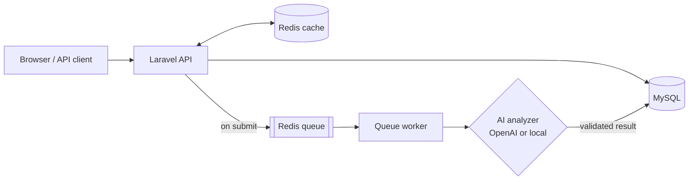

<div align="center">

# OpsFlow AI

**Operational workflows. Intelligent triage.**

An internal operations platform where employees raise requests, AI suggests how to handle them, and managers make the call.


</div>

---

## What it does

Companies receive a steady stream of operational work: access requests, infrastructure changes, incidents, compliance reviews, billing issues and customer escalations. OpsFlow AI gives that work one controlled path:

1. **An employee submits a request.**
2. **AI analyzes it in the background** and suggests a category, priority, risk level, owning team and next action.
3. **A manager reviews it**, with the AI recommendation as advice only, then approves or rejects it.
4. **Operations staff deliver it**, and every step is recorded in an audit trail.

AI never approves, rejects or changes a request on its own. People make every decision.

## Features

**Workflow**
- Controlled lifecycle: `draft → submitted → under review → approved / rejected → in progress → completed`. Invalid jumps are refused.
- Assignment to managers and admins, with a full reassignment history.
- Comments on requests, and a status history with reasons.
- Separation of duties: nobody can review their own request.

**AI analysis**
- Runs asynchronously on a Redis queue worker, so submitting never waits on the AI.
- Uses OpenAI when an API key is configured, otherwise a built-in rule-based analyzer that needs no key.
- Every field the AI returns is validated before it is stored.
- Automatic retries with backoff, and a fallback to the local analyzer if the provider fails.

**Access and security**
- Three roles, Employee, Manager and Admin, enforced on the server for every page and API call.
- Session login for the web app (CSRF-protected) and token login for API clients.
- Rate-limited login, validated input, and no secrets or request content in logs.

**Visibility**
- Dashboard with open work, pending reviews, high-priority requests and AI pipeline health.
- Statistics cached in Redis, scoped to what each user is allowed to see.
- Audit log of every create, transition, assignment, comment and AI result.

**Interface**
- Clean, responsive UI with light and dark themes.
- Search, filters, sorting and pagination on request lists.
- Review queue for managers, request detail pages with an AI recommendation panel, and an admin operations console.

## How it works



MySQL is the source of truth. Redis holds the job queue and the dashboard cache.

## Tech stack

| Layer | Technology |
| --- | --- |
| Backend | PHP 8.4, Laravel 13, Laravel Sanctum |
| Data | MySQL 8.4, Redis 7 |
| Frontend | Blade, Alpine.js, Tailwind CSS 4, Vite |
| Testing | PHPUnit, Laravel Pint |
| Environment | Docker Compose |

## Getting started

**Requirements:** Docker, plus Node.js 20+ for building the frontend.

```bash
# 1. Clone and configure
git clone <your-repo-url> opsflow-ai
cd opsflow-ai
cp .env.example .env

# 2. Build and install
docker compose build
docker compose run --rm app composer install
docker compose run --rm app php artisan key:generate

# 3. Start everything (app, queue worker, MySQL, Redis)
docker compose up -d

# 4. Create the database and demo data
docker compose exec app php artisan migrate --seed

# 5. Build the frontend
npm install
npm run build
```

Open **http://localhost:8000**.

### Demo accounts

Created by the seeder for local use only. The password for each is `password`.

| Role | Email |
| --- | --- |
| Employee | `employee@opsflow.test` |
| Manager | `manager@opsflow.test` |
| Admin | `admin@opsflow.test` |

### Try it

1. Sign in as the **employee**, create a request and submit it. The AI recommendation appears within seconds.
2. Sign in as the **manager**, open the **Review queue**, then assign, approve, start and complete the request.
3. Sign in as the **admin** and open the **Operations console** to see the full audit trail.

## Configuration

Everything runs out of the box. These optional settings live in `.env`:

| Variable | Purpose |
| --- | --- |
| `OPENAI_API_KEY` | Enables OpenAI analysis. Leave it empty to use the built-in analyzer. |
| `OPENAI_MODEL` | OpenAI model to use (default `gpt-4o-mini`). |
| `APP_REPOSITORY_URL` | Shows a "View on GitHub" button on the landing page. |

When an OpenAI key is set, each request's title and description are sent to OpenAI for analysis.

## Useful commands

```bash
docker compose run --rm app php artisan test       # run the test suite
docker compose logs -f queue                        # watch AI jobs being processed
docker compose exec app php artisan queue:restart   # reload the worker after code changes
docker compose exec app php artisan queue:failed    # list failed jobs
npm run dev                                         # frontend hot reload while editing
```

Tests use an in-memory database and mock all AI calls, so they never need an API key.

## API

The same REST API powers the web app and is available to token clients.

```bash
curl -X POST http://localhost:8000/api/auth/login \
  -H "Accept: application/json" -H "Content-Type: application/json" \
  -d '{"email":"employee@opsflow.test","password":"password"}'
```

Send the returned token as `Authorization: Bearer <token>`.

| Method | Endpoint | Description |
| --- | --- | --- |
| `GET` / `POST` | `/api/requests` | List (search, filter, sort, paginate) or create requests |
| `GET` / `PATCH` | `/api/requests/{id}` | View or edit a request |
| `POST` | `/api/requests/{id}/{action}` | `submit`, `review`, `approve`, `reject`, `start`, `complete`, `assign` |
| `GET` | `/api/requests/{id}/ai-analysis` | AI recommendation and its status |
| `GET` / `POST` | `/api/requests/{id}/comments` | Read or add comments |
| `GET` | `/api/requests/{id}/history` | Status history |
| `GET` | `/api/requests/{id}/activity` | Audit trail (managers and admins) |
| `GET` | `/api/dashboard/stats` | Dashboard statistics |
