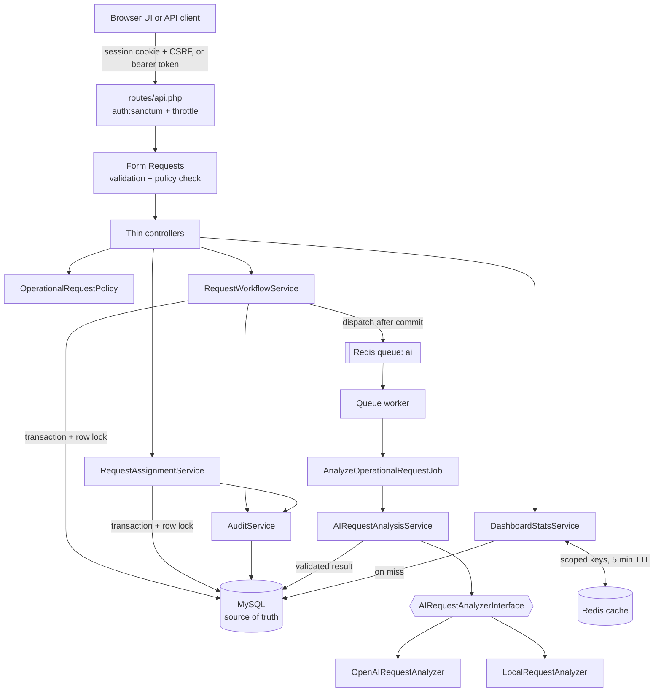
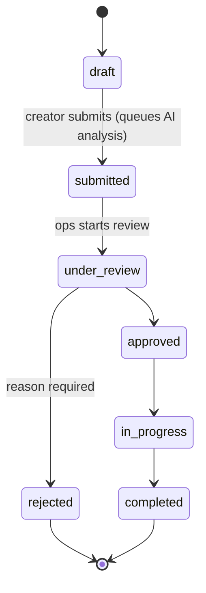

# OpsFlow AI

An internal operations platform built with Laravel 13, MySQL and Redis. Employees raise operational requests (access, infrastructure, incidents, compliance reviews, billing issues and more). Operations staff move them through a controlled, auditable lifecycle, and an asynchronous AI analysis step suggests category, priority, risk, owning team and a next action.

> **Status: all three phases complete.** The backend (workflow engine, RBAC, REST API, AI analysis pipeline, Redis queue and cache, comments, audit log) and a web interface (landing page, dashboard, request management, review queue, operations console) are implemented and tested. This README only describes what exists today; see [Known limitations](#known-limitations).

## Features (implemented)
## Features 

**Core workflow (Phase 1)**

- **Token authentication** with Laravel Sanctum. Login is rate-limited and returns the same error whether the email is unknown or the password is wrong.
- **Three roles**: `employee`, `manager` and `admin`, enforced server-side by a Laravel Policy.
- **Workflow engine** with an explicit state graph. Requests cannot skip or reverse states, and an invalid move returns a structured `409`.
- **Status history and assignment logs**, filtering, pagination, Form Request validation and API Resources throughout.

**AI-assisted operations (Phase 2)**

- **Asynchronous AI analysis** on submission, via a Redis-backed queue job. The API returns immediately.
- **Provider abstraction**: an OpenAI analyzer when `OPENAI_API_KEY` is set, otherwise a deterministic rule-based local analyzer. The local analyzer is also the fallback when the provider fails.
- **Strict output validation**: every field the model returns is checked against the application's enums before it is stored.
- **Advisory only**: AI never approves, rejects, completes or edits a request. Its suggestions are stored separately for reviewers to use.
- **Redis-cached dashboard statistics**, scoped by role so employees never see counts for requests they can't view, and invalidated after every committed change.
- **Comments** on requests, using the same visibility rules as the request itself.
- **Audit log** of every significant action, written in the same transaction as the change it records.

## Web interface

Server-rendered Blade pages enhanced with Alpine.js and styled with Tailwind CSS 4. There is no SPA framework. After signing in with a normal session, each page loads its data from the same `/api/*` endpoints that token clients use, through Sanctum's stateful (cookie and CSRF) mode. Authorization therefore lives in one place, the API's policies. Page routes add matching `can:` gates, so users never land on a screen they cannot use.

| Page | Path | Who |
| --- | --- | --- |
| Landing page | `/` | Public |
| Sign in | `/login` | Guests |
| Overview: KPIs, requests by status, AI pipeline, recent requests and activity | `/app` | Everyone (scoped by role) |
| My requests: search, filters, sort, pagination, deep-linkable URLs | `/app/requests` | Everyone |
| All requests | `/app/all-requests` | Managers, admins |
| New and edit request (validation errors shown per field) | `/app/requests/new`, `/app/requests/{id}/edit` | Creator; edit only while a draft |
| Request details: lifecycle stepper, workflow actions, AI panel, comments, status history, assignment log, audit timeline | `/app/requests/{id}` | Anyone allowed to view the request; the timeline is for operations only |
| Review queue: stage tabs, AI risk at a glance, approve, reject, start, complete | `/app/review` | Managers, admins |
| Operations console: workload, AI pipeline health, staff directory, audit trail | `/app/admin` | Admins (read-only) |

**AI panel.** Shown in a separate teal-tinted panel labelled "Advisory · a person decides", with distinct pending, processing, completed and failed states. It notes where the suggestion differs from the requester's category or the current priority, and shows the provider, any fallback reason, the timestamp and the attempt count.

**UX details.**

- Confirmation dialogs (native `<dialog>`) guard submit, approve, reject and complete, and reject requires a reason.
- Toasts report success and failure.
- Skeletons cover loading, and every list has an empty state.
- Table rows become cards on small screens, and there's a mobile navigation drawer.
- Visible focus rings, labelled controls, a skip link and `prefers-reduced-motion` support.

### Design system ("Ledger")

| Token group | Values |
| --- | --- |
| Type | Geist (UI), Geist Mono (IDs, labels, data); 15px body, tabular numbers for figures |
| Neutrals | `canvas`, `surface`, `subtle`, `ink`, `ink-soft`, `muted`, `line`, `line-strong` |
| Accent | `primary` cobalt (actions), with `primary-ink` for text links |
| AI | `ai` teal, used only for AI-generated content |
| Semantic | `ok`, `warn`, `danger`, `info`, each with a `-soft` background |
| Shape | 12px cards, 8px controls, hairline borders, two shadow levels |

All tokens are CSS variables in `resources/css/app.css`. A `.dark` class swaps them, so components never use raw colours. The theme follows the OS setting until the user toggles it. Components are plain CSS classes (`card`, `btn` with `btn-primary`, `btn-secondary`, `btn-ghost` and `btn-danger`, `input`, `pill` with `tone-*`, `table`, `nav-link`, `skeleton`).

Two layouts were adapted, not installed, from 21st.dev components, which are React/shadcn: the landing navigation from "Hero Section 6", and the day-grouped activity rail from "Activity Timeline". Icons are inlined Lucide paths (ISC).

## Architecture



| Concern | Where it lives | Failure response |
| --- | --- | --- |
| Is the input well-formed? | Form Requests in `app/Http/Requests` | `422` with field errors |
| Is this user allowed to do this? | `app/Policies/OperationalRequestPolicy.php` | `403` |
| Does the request's current state allow it? | `app/Services/RequestWorkflowService.php` | `409` with allowed transitions |

### Request lifecycle



The graph is defined once, in `App\Enums\RequestStatus::allowedTransitions()`. Each API response includes `allowed_transitions`, so a client never has to hard-code it.

## AI analysis

### Flow

1. The employee calls `POST /api/requests/{id}/submit`.
2. Inside one transaction, `RequestWorkflowService` locks the row, validates the transition, and writes the status, the history row, the audit record and a `pending` `ai_analyses` row.
3. `AnalyzeOperationalRequestJob` is dispatched from a `DB::afterCommit()` callback, so it can never run against an uncommitted or rolled-back submission, and a rollback never leaves an orphaned uniqueness lock. The API responds without waiting.
4. A worker picks the job off the Redis `ai` queue. `AIRequestAnalysisService` runs the configured analyzer, validates the output, stores the result and writes an `ai_analysis_completed` audit record.
5. Authorized users read the result at `GET /api/requests/{id}/ai-analysis`, or embedded in `GET /api/requests/{id}`.

### Provider abstraction

`App\Services\AI\AIRequestAnalyzerInterface` has two implementations, bound in `AppServiceProvider`:

| Analyzer | Used when | Notes |
| --- | --- | --- |
| `OpenAIRequestAnalyzer` | `OPENAI_API_KEY` is set | Chat Completions with a strict JSON schema whose enums come from the PHP enums. 5 s connect and 20 s request timeouts. The system prompt tells the model to treat request text as untrusted data. |
| `LocalRequestAnalyzer` | No key configured (default), or as the fallback | Deterministic keyword scoring per category, with title matches weighted double. The requester's own category wins ties or when there's no signal. Urgency and sensitivity signals and the due date drive priority and risk. Makes no network calls. |

Controllers never see a provider: they read stored `AIAnalysis` rows.

### Output validation

`AnalysisResult::fromArray()` is the only way to turn provider output into a result:

- `category`, `priority`, `risk_level` and `suggested_team` must be valid enum values. A model cannot invent a category, team or action such as `auto_approve`.
- `summary` and `suggested_action` are required, stripped of markup and control characters, and limited to 500 characters.
- Validation errors name the failing fields but never echo the values, because model output may repeat request content.

### Retries, fallback and failure

| Situation | Behavior |
| --- | --- |
| Transient provider error (timeout, 5xx, 429) with attempts remaining | Rethrown; the queue retries after 10 s, then 60 s (`tries = 3`) |
| Transient error on the final attempt | Falls back to `LocalRequestAnalyzer`; `fallback_reason` is recorded |
| Invalid output, refusal, or auth error | Falls back immediately; retrying would not help |
| Unexpected exception after all attempts | `failed()` marks the analysis `failed` with a safe code (e.g. `internal_error`) and writes an `ai_analysis_failed` audit record |

In every case the request's workflow state is untouched, so reviewers can carry on without AI input.

**Idempotency.** `ai_analyses.operational_request_id` is unique, rows are created with `createOrFirst`, and a `completed` analysis is never redone. The job also implements `ShouldBeUnique`, keyed by request id, so duplicate dispatches collapse into one queued job.

**Logging.** Logs record only identifiers, provider, attempt number, duration and error codes; never request text, model output or credentials.

## Redis

| Use | Details |
| --- | --- |
| Queue | `QUEUE_CONNECTION=redis`. AI jobs run on the `ai` queue; the worker listens to `ai,default`. Failed jobs go to the `failed_jobs` table. |
| Dashboard cache | `CACHE_STORE=redis`. `GET /api/dashboard/stats` is cached for 300 s. |
| Job uniqueness | `ShouldBeUnique` locks are stored in the Redis cache. |

**Cache scoping and invalidation**

- Keys are `dashboard:stats:{version}:operations` (shared by managers and admins, who see everything) and `dashboard:stats:{version}:user:{id}` (one per employee). Employees can never be served another user's counts.
- `OperationalRequestObserver` runs after commit (`ShouldHandleEventsAfterCommit`) and sets a new random version, which invalidates every scope at once. Because the version is random rather than a counter, an evicted or flushed version key can never bring back an old entry. Old entries expire on their TTL, and rolled-back changes never invalidate anything.
- MySQL remains the source of truth. If Redis is unreachable, the stats are computed from MySQL and the cache failure is logged as a warning, so the endpoint does not fail.

## Audit log

`AuditService::record()` is called inside the existing service transactions, so an audit row commits or rolls back together with the change it describes.

| Action | Recorded by | Metadata |
| --- | --- | --- |
| `request_created`, `request_updated` | `RequestWorkflowService` | category and priority; changed field names (never values), plus the priority change |
| `request_submitted`, `request_approved`, `request_rejected`, `request_completed`, `status_changed` | `RequestWorkflowService::transition()` | from, to, reason |
| `request_assigned` | `RequestAssignmentService` | assignee, previous assignee, assignment id |
| `comment_added` | `RequestCommentController` | comment id only (the body is not copied) |
| `ai_analysis_completed`, `ai_analysis_failed` | `AIRequestAnalysisService` | provider, fallback reason, suggested priority, risk and team; or error code (actor is "system") |

Metadata keys containing `password`, `token`, `secret`, `api_key`, `authorization` or `credential` are dropped, and strings are capped at 500 characters. The activity feed (`GET /api/requests/{id}/activity`) is visible to managers and admins only, because it contains reviewer reasons and risk assessments.

## Roles and permissions

| Action | Employee | Manager | Admin |
| --- | :-: | :-: | :-: |
| Create a request | ✓ | ✓ | ✓ |
| View requests, comments and AI analysis | own + assigned | all | all |
| Comment | on visible requests | ✓ | ✓ |
| Edit a request | own, while `draft` | any open request | any open request |
| Submit | own only | own only | own only |
| Start review / approve / reject | — | ✓ (not own requests) | ✓ (not own requests) |
| Assign / start / complete | — | ✓ | ✓ |
| View the audit activity feed | — | ✓ | ✓ |
| Dashboard stats | own requests | all requests | all requests |

## Database design

| Table | Purpose | Notable constraints and indexes |
| --- | --- | --- |
| `users` | Accounts with a `role` | `role` indexed |
| `operational_requests` | The core entity | FKs to `users`; indexes `(created_by, created_at)`, `(status, created_at)`, `(assigned_to, status)`, `priority`, `category` |
| `request_status_histories` | Append-only transition log | `(operational_request_id, created_at)` |
| `request_assignments` | Append-only assignment log | `(operational_request_id, created_at)` |
| `ai_analyses` | One advisory analysis per request | **unique** `operational_request_id`; `status` indexed |
| `request_comments` | Discussion on a request | `(operational_request_id, created_at)`; FK to author |
| `audit_logs` | Append-only audit trail | `(entity_type, entity_id, created_at)` for activity feeds; `(action, created_at)`; nullable `actor_id` for system actions |
| `personal_access_tokens`, `jobs`, `failed_jobs`, `cache` | Laravel defaults | |

All Phase 2 tables were added with new, additive migrations; no existing table was altered. Enum-like columns are short strings cast to PHP backed enums (`app/Enums`).

**Mass-assignment protection.** Ownership, status, assignment, workflow timestamps, AI-analysis foreign keys and comment authorship are never fillable; services and relations set them explicitly. Tests cover spoofed `status`, `created_by`, `assigned_to` and `user_id` fields.

## REST API

All endpoints are under `/api` and return JSON. Everything except login requires `Authorization: Bearer <token>`.

| Method | Path | Description |
| --- | --- | --- |
| POST | `/auth/login` | Exchange email and password for a token (5/min per email+IP) |
| GET | `/auth/me` | Current user |
| POST | `/auth/logout` | Revoke the current token |
| GET | `/dashboard/stats` | Cached operational counters and AI pipeline counts, scoped to the caller |
| GET | `/activity` | Recent audit events across requests (managers and admins) |
| GET | `/users/assignable` | Managers and admins a request can be assigned to (managers and admins) |
| GET | `/requests` | Paginated list; filters `status`, `priority`, `category`, `assigned_to`, `created_by`, `search` (title), `sort` (`newest`, `oldest`, `priority`, `due_soon`), `per_page` |
| POST | `/requests` | Create a draft request |
| GET | `/requests/{id}` | Request with creator, assignee, assignment log and AI analysis |
| PUT/PATCH | `/requests/{id}` | Edit content fields |
| GET | `/requests/{id}/history` | Status transition history |
| GET | `/requests/{id}/ai-analysis` | Analysis status, recommendation, or safe error |
| GET | `/requests/{id}/comments` | Comments, oldest first (50 per page) |
| POST | `/requests/{id}/comments` | Add a comment (`body`) |
| GET | `/requests/{id}/activity` | Audit trail, newest first (managers and admins) |
| POST | `/requests/{id}/submit` | `draft → submitted`; queues AI analysis |
| POST | `/requests/{id}/review` | `submitted → under_review` |
| POST | `/requests/{id}/approve` | `under_review → approved` (optional `reason`) |
| POST | `/requests/{id}/reject` | `under_review → rejected` (`reason` required) |
| POST | `/requests/{id}/start` | `approved → in_progress` |
| POST | `/requests/{id}/complete` | `in_progress → completed` (optional `reason`) |
| POST | `/requests/{id}/assign` | Assign to a manager or admin (`assignee_id`, optional `note`) |

### AI analysis response

```json
{
  "data": {
    "status": "completed",
    "advisory": true,
    "provider": "local",
    "recommendation": {
      "category": "incident",
      "priority": "high",
      "risk_level": "high",
      "suggested_team": "platform",
      "summary": "Production API latency above 2s: p95 latency on checkout has exceeded 2s in production since 09:00.",
      "suggested_action": "Page the platform on-call, confirm the scope of impact and open an incident channel. Requires manager sign-off before execution."
    },
    "attempts": 1,
    "analyzed_at": "2026-11-02T16:38:07+00:00",
    "updated_at": "2026-11-02T16:38:07+00:00"
  }
}
```

`status` is one of `pending`, `processing`, `completed` or `failed`. A completed fallback adds `"fallback_reason": "provider_timeout"`. A failed analysis returns `"error": {"code": "...", "message": "AI analysis is unavailable for this request. Reviewers can proceed without it."}`.

### Error format

| Status | When | Body |
| --- | --- | --- |
| 401 | Missing or invalid token | `{"message": "Unauthenticated."}` |
| 403 | Policy denies the action | `{"message": "..."}` |
| 404 | Unknown resource, or no analysis yet | `{"message": "...", "error": "not_found" \| "analysis_not_found"}` |
| 409 | Invalid workflow transition, or unassignable state | `{"message", "error": "invalid_status_transition", "current_status", "requested_status", "allowed_transitions"}` |
| 422 | Validation failure | `{"message", "errors": {"field": ["..."]}}` |
| 429 | Rate limit exceeded | `{"message": "Too Many Attempts."}` |

## Running locally

The only prerequisite is Docker. PHP 8.4, MySQL 8.4 and Redis 7 run in containers defined in `compose.yaml`.

```bash
cp .env.example .env
docker compose build
docker compose run --rm app composer install
docker compose run --rm app php artisan key:generate
docker compose up -d                       # app on :8000, queue worker, MySQL on :3307, Redis on :6380
docker compose exec app php artisan migrate --seed

npm install && npm run build               # frontend assets (Node 20+ on the host); use `npm run dev` while editing
```

Then open http://localhost:8000. Use **Launch demo** and pick a seeded account; the sign-in page lists them in the local environment only.

**Queue worker.** The `queue` service runs `php artisan queue:work redis --queue=ai,default` and restarts automatically.

```bash
docker compose logs -f queue                    # watch jobs run
docker compose exec app php artisan queue:restart   # after code changes, so the worker loads new code
docker compose exec app php artisan queue:failed    # inspect permanently failed jobs
```

### Environment variables

| Variable | Default | Purpose |
| --- | --- | --- |
| `QUEUE_CONNECTION` | `redis` | Queue backend |
| `CACHE_STORE` | `redis` | Cache backend for stats and job-uniqueness locks |
| `REDIS_HOST` / `REDIS_PORT` | `redis` / `6379` | Redis service in Compose |
| `OPENAI_API_KEY` | *(empty)* | Enables the OpenAI analyzer. Leave empty to use the local analyzer. |
| `OPENAI_MODEL` | `gpt-4o-mini` | Any Chat Completions model that supports structured outputs |
| `OPENAI_TIMEOUT` | `20` | Request timeout in seconds |
| `OPENAI_BASE_URL` | `https://api.openai.com/v1` | Override for a compatible gateway |
| `APP_REPOSITORY_URL` | *(empty)* | Shows "View on GitHub" on the landing page when set |
| `SANCTUM_STATEFUL_DOMAINS` | localhost and the `APP_URL` host | Hosts whose browser sessions may call `/api/*`; add your host if you serve the UI elsewhere |

When `OPENAI_API_KEY` is set, the request title, description, declared category, priority and due date are sent to OpenAI. Leave it unset if that's not acceptable for your data.

### Seeded accounts (local development only)

| Email | Role | Password |
| --- | --- | --- |
| `admin@opsflow.test` | admin | `password` |
| `manager@opsflow.test` | manager | `password` |
| `employee@opsflow.test` | employee | `password` |

These are throwaway development credentials created by the seeder. Never use them outside a local environment.

## Testing

```bash
docker compose run --rm app php artisan test
```

Tests run on in-memory SQLite with the `sync` queue and `array` cache (see `phpunit.xml`), and `OPENAI_API_KEY` is forced empty. Every external HTTP call is mocked with `Http::fake()` and `Http::preventStrayRequests()`, so no test can reach a paid API.

| Test file | Covers |
| --- | --- |
| `Unit/RequestStatusTest` | All 49 from/to status pairs against the transition graph |
| `Unit/LocalRequestAnalyzerTest` | Classification for each category, tie-breaking, priority and risk rules, due-date urgency, determinism |
| `Unit/AnalysisResultTest` | Rejection of invented enums, missing or overlong fields and non-strings; markup stripping; no value echo |
| `Feature/OpenAIRequestAnalyzerTest` | Strict schema request, parsing, prompt-injected output, refusals, 5xx/429/401/timeout mapping, container binding |
| `Feature/AIAnalysisPipelineTest` | Dispatch after commit on the `ai` queue, persistence without touching the request, idempotent re-runs, unique-lock collapse, retry vs. fallback, failure handling |
| `Feature/AIAnalysisApiTest` | Pending, completed and failed responses; no internals leaked; 404 for drafts; 403 for other employees |
| `Feature/RequestCommentTest` | Visibility, validation, author spoofing, audit without copying the body |
| `Feature/AuditLogTest` | Full ordered trail with actors and metadata, rollback leaves no audit, sanitization, ops-only activity |
| `Feature/DashboardStatsTest` | Counts, per-user isolation, cache hit with zero queries, invalidation, rollback, Redis-down fallback |
| `Feature/WebInterfaceTest` | Public landing page, session login and logout, generic failure, role-gated pages and navigation, request-page policies, session-authenticated API calls |
| `Feature/DashboardApiExtensionsTest` | Title search with literal `%`, priority and due-date sorting, allow-listed sort, embedded AI analysis, ops-only activity feed and staff list, AI pipeline stats and their invalidation |
| Phase 1 feature tests | Auth, CRUD, filters, workflow, assignment, transaction rollback, stale-model protection |

## Known limitations

- Tests use SQLite and the array cache. Redis and MySQL behavior was verified manually against the Docker services rather than in CI.
- The OpenAI analyzer is exercised only through mocked HTTP in this repository; it has not been run against the live API.
- The local analyzer is keyword-based. It handles clear-cut requests well and ambiguous ones conservatively, by keeping the requester's category.
- There is no full-text audit search; the activity feed is newest-first with pagination.
- Dashboard stats can be up to 5 minutes stale if Redis misses an invalidation (e.g. during a Redis outage).
- A completed analysis is not re-run when operations staff later edit the request. There is no reliable staleness signal yet: `updated_at` also changes on every workflow transition, so comparing it with `analyzed_at` gives false positives.
- The UI has no browser-level (end-to-end) tests. Pages, gates and the session-to-API flow are covered by feature tests and were checked over HTTP against the running app, but rendering was not checked in an automated browser.
- Admin user and role management does not exist. The Operations console is read-only and says so.
- There is no real-time push (WebSockets). The request page polls the analysis endpoint every 3 seconds while a job is queued, for up to about 2 minutes.
- Unexpected (non-provider) job exceptions, such as database errors, are stored in `failed_jobs` with Laravel's default exception text, which can include SQL bindings.

## Possible next steps

- Admin user and role management (endpoint, policy, audit and UI)
- Browser end-to-end tests (e.g. Playwright) for the main workflow
- Re-analysis when request content is edited after submission

## Tech stack

HEAD
PHP 8.4 · Laravel 13 · Laravel Sanctum · MySQL 8.4 · Redis 7 · Blade · Alpine.js 3 · Tailwind CSS 4 · Vite · PHPUnit 12 · Laravel Pint · Docker Compose
PHP 8.4 · Laravel 13 · Laravel Sanctum · MySQL 8.4 · Redis 7 (provisioned; used from Phase 2) · PHPUnit 12 · Laravel Pint · Docker Compose

 
